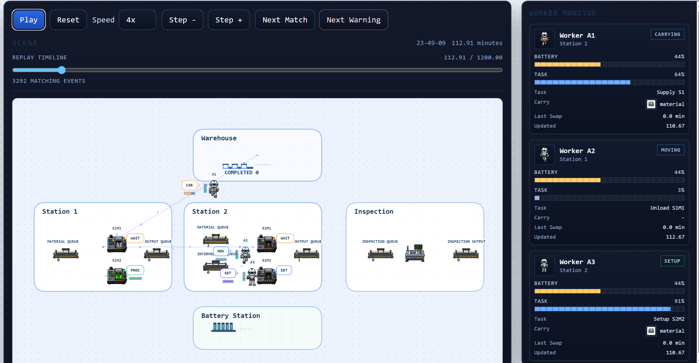

# ManSim

ManSim은 휴머노이드 작업자, 설비, 재고와 운반 흐름을 함께 다루는 discrete-event simulator입니다.
HumanoidSim의 task/primitive 계약을 사용하고, 실행 결과를 Results Hub, KPI, Gantt와 Replay Studio 3D로 제공합니다.
현재 릴리스는 **v0.6.0**입니다.

## 설치

Python 3.12 이상을 권장합니다. HumanoidSim을 같은 상위 디렉터리에 설치합니다.
기본 시뮬레이션과 규칙 기반 정책에는 GPU, LLM, ROS2 또는 Gazebo가 필요하지 않습니다.

~~~powershell
git clone https://github.com/Ha-An/ManSim.git
git clone https://github.com/Ha-An/HumanoidSim.git
cd ManSim
py -3.12 -m venv .venv
.\.venv\Scripts\Activate.ps1
python -m pip install -r requirements.txt
python -m pip install -e ..\HumanoidSim
python -m humanoidsim validate-catalog
python -m pip check
~~~

ADP 학습·추론에는 requirements-adp.txt, 개발 검증에는 requirements-dev.txt를 추가 설치합니다.
기본 ADP 학습은 CUDA GPU를 요구하고, rollout은 CPU에서 실행합니다.
Replay Studio의 Node.js 설치와 CUDA 확인은 [설치 안내](docs/installation.md)를 참고하세요.

## 빠른 실행

기본 scenario는 `factory_mfg_basic`, 기본 정책은 `rolling_horizon_dedicated_roles`입니다.
새 결과는 Hydra 출력 디렉터리에 저장되며 기존 실험과 별도 경로를 사용하세요.

~~~powershell
.\.venv\Scripts\python.exe main.py scenario=mfg_flow_shop decision=immediate_shared hydra.run.dir=outputs/my_run
~~~

브라우저와 Replay 서버 자동 실행을 끄려면 다음 override를 추가합니다.

~~~text
runtime.ui.auto_open_results=false runtime.ui.auto_start_replay_studio_3d=false
~~~

| Scenario | 주요 구성 | 목적 |
| --- | --- | --- |
| `factory_mfg_basic` | 기본 제조 공정, 배터리 교환·전달 | 제품 생산과 운영 지표 |
| `mfg_flow_shop` | 병렬 설비, 유한 버퍼, 직접 충전 | Throughput 또는 초기 batch Makespan |
| `shipyard_basic` | 외관 tile 작업과 cart logistics | 완료 surface tile과 Makespan |

## Flow Shop 설정

`configs/scenario/mfg_flow_shop.yaml`이 환경 설정의 기준입니다.

| 항목 | 기본값 |
| --- | --- |
| 운영기간 | 5일, 하루 480분 |
| Station 1 / 2 설비 | 각각 2대 |
| Station 1 가공시간 | triangular 7 / 8.5 / 11분 |
| Station 2 가공시간 | triangular 10 / 12.5 / 16분 |
| Warehouse | 26 x 15 tiles, 4개 선반 행, 40슬롯 |
| 초기 자재 / 일일 보충 목표 | 30 / 30개 |
| S1 material input / output | 4 / 2 |
| S2 material / intermediate / output | 4 / 4 / 2 |
| Inspection input / pass / scrap | 각각 3 |
| Inspection desk | 1개 |
| CompletedProducts / ScrapDisposal | 용량 제한 없는 terminal store |

자재 20·30·40개 비교는 동일한 40슬롯 창고에서 초기 재고와 보충 목표만 변경합니다.
보충은 매일 목표량까지 채우는 것이며 목표량을 무조건 더하는 방식이 아닙니다.
예전 30슬롯 창고 결과는 현재 레이아웃의 결과와 같은 조건으로 취급하지 않습니다.

버퍼 용량은 실제 점유량과 inbound reservation을 함께 계산합니다.
Output 공간이 없으면 산출물이 설비 안에 남아 다음 cycle을 시작하지 못합니다.
Station 자재 보충량은 고정 재고 목표가 아니라 미충족 설비 수요와 queue/inbound 재고로 계산합니다.
창고 혼잡·교착은 스트레스 조건의 동작이며, 이를 없애기 위해 경로나 양보 규칙을 자동 변경하지 않습니다.

설비 고장은 실제 가공 누적시간 기준 평균 300분의 지수분포를 사용합니다.
240 가공분마다 예방정비 후보가 생성되고, 완료 후 다음 240 가공분 동안 hazard를 0.5배로 줄입니다.
Inspection은 desk load, inspect, desk unload의 세 독립 task입니다.
양품이 CompletedProducts에 실제 배치된 시점에 완료 제품으로 계산합니다.

Worker는 자기 도크에서 직접 충전합니다. 배터리 위험이 있는 작업도 정책이 선택할 수 있습니다.
작업 중 방전되면 item과 예약을 해제하고, 다음 day boundary에 지정 도크에서 완충 상태로 복귀합니다.
Item 선행조건, 버퍼 용량, 자원 독점과 물리적 충돌은 여전히 hard constraint입니다.

### 목적함수

- `maximize_throughput`: 매일 보충하고 지정한 일수까지 실행합니다. 기본값입니다.
- `minimize_makespan`: 보충 없이 초기 자재가 양품 또는 최종 폐기품으로 모두 종결되면 종료합니다. 안전 상한은 30일입니다.

~~~powershell
.\.venv\Scripts\python.exe main.py scenario=mfg_flow_shop scenario.objective.mode=minimize_makespan
.\.venv\Scripts\python.exe main.py scenario=mfg_flow_shop scenario.objective.mode=maximize_throughput scenario.horizon.num_days=5
~~~

### 정책

| Mode | 할당 방식 | 일반 생산 역할 |
| --- | --- | --- |
| `immediate_shared` | 유휴 worker에게 고정 우선순위로 할당 | 공유 |
| `immediate_dedicated_roles` | 유휴 worker의 적격 후보 중 선택 | 실행 전 LPT 배분 |
| `rolling_horizon_shared` | 정확한 window 경계에서 미시작 queue 재할당 | 공유 |
| `rolling_horizon_dedicated_roles` | 같은 주기, owner 제약 유지 | 실행 전 LPT 배분 |
| `random_feasible_dispatch` | 이벤트 기반 feasible 후보 무작위 선택 | 공유 |
| `simulation_based_adp` | 가치망과 beam search로 joint assignment 선택 | 공유 |

Rolling Horizon은 독립 coordinator가 기본 5분 간격으로 실행하며 worker polling에 의존하지 않습니다.
실행 중 task는 선점하지 않습니다. `mfg_flow_shop`의 critical repair는 주기 밖에서 idle queue를 갱신할 수 있습니다.
19개 세부 역할과 priority 설정은 각 decision YAML에 있습니다.
기본 비교에서는 명시적 WAIT를 끄지만, 수행 가능한 task가 없는 강제 유휴는 허용합니다.

## ADP 학습

기본 profile은 `configs/adp/mfg_flow_shop_throughput.yaml`입니다.
Worker 3이 기본이며, worker 2~6 중 하나를 지정해 fleet별 checkpoint를 학습할 수 있습니다.
기본 trainer는 여러 fleet을 하나의 모델로 통합하지 않습니다.

~~~powershell
.\.venv\Scripts\python.exe -m pip install -r requirements-adp.txt
.\.venv\Scripts\python.exe -m manufacturing_sim.adp.train --worker-counts 3 --background
~~~

- 초기 Random Feasible 50 episode, 이후 최대 75회 x 10 episode: 최대 800 episode.
- CPU 10 process, wave당 10 episode. Network update는 `cuda:0`.
- n-step TD: 최대 `n=30`, greedy mismatch에서 조기 절단, target tau `0.03`.
- Replay: 최근 100 episode, update당 현재 10개와 과거 20개. Episode holdout은 SGD에서 제외.
- MSE, Adam, batch 512, 초기 1 epoch와 이후 2 epoch. Potential shaping과 conservative gate는 비활성.
- Epsilon: `0.50 -> 0.15 -> 0.08 -> 0.05` (iteration `0/25/50/75`).
- Screening: `0, 5, ..., 75`, 각 10 seed. 상위 2개 checkpoint를 별도 20 seed씩 최종 평가.
- 최소 45회 이후 생산량 plateau 조건에 따라 조기 종료할 수 있습니다. 수렴이나 최고 성능을 보장하는 종료 판정은 아닙니다.

`--background`는 명령을 즉시 반환하고 실시간 HTML 모니터를 엽니다.
모니터에는 best iteration, validation 생산량, 완료 학습별 경과시간과 현재 진행 단계가 표시됩니다.
재부팅 후 정확한 중간 재개는 지원하지 않습니다. 실행 중인 코드와 설정을 변경하지 마세요.

결과에는 `best.pt`, `last.pt`, iteration checkpoint, CSV/JSON 통계와 `training_dashboard.html`이 포함됩니다.
Checkpoint는 feature schema, fleet, 환경과 timing을 검증하고, 새 checkpoint는 자재 공급 조건도 검증합니다.
불일치하면 실행을 거부합니다. 현재 schema는 `mfg_flow_shop_adp_v10`입니다.

~~~powershell
.\.venv\Scripts\python.exe main.py scenario=mfg_flow_shop decision=simulation_based_adp decision.adp.checkpoint_path=C:/path/to/best.pt
~~~

자세한 설정은 [TD 학습](docs/adp_n_step_td.md), [백그라운드 실행](docs/adp_background_training.md),
[학습 그래프 해석](docs/adp_training_dashboard.md), [속도 개선](docs/adp_efficiency.md)에 있습니다.
TD 적합 오차 감소와 실제 미래 생산량 예측 정확도·정책 생산성 향상은 별도로 확인해야 합니다.

## 정책 비교

빠른 기본 비교는 worker 3, 5일, 고정 seed `50001~50005`에서 ADP, Immediate Shared,
Random Feasible을 평가하는 15-run 실험입니다.

~~~powershell
.\.venv\Scripts\python.exe experiments/factory_policy_comparison/run_experiment.py --adp-checkpoint C:/path/to/best.pt --dry-run
.\.venv\Scripts\python.exe experiments/factory_policy_comparison/run_experiment.py --adp-checkpoint C:/path/to/best.pt --jobs 10
~~~

자재 20·30·40개, worker 2~6별 학습과 고정 seed 100개 비교는 다음 runner로 준비합니다.
`--all-policies`가 없으면 3개 정책, 있으면 6개 정책을 비교합니다.
새 출력 디렉터리를 사용해야 하며 아래 명령은 장시간 학습과 평가를 모두 실행합니다.

~~~powershell
.\.venv\Scripts\python.exe -m experiments.mfg_flow_shop_paper.train_inventory --fresh --all-policies --fill 30 --output experiments/mfg_flow_shop_paper/results/new_materials30 --background
~~~

평균·표준편차·95% CI, paired difference와 win/tie/loss를 기존 비교 대시보드에서 확인합니다.
물리적 환경이나 timing이 다른 과거 결과는 재사용하지 않습니다.
상세 절차는 [기본 비교](experiments/factory_policy_comparison/README.md)와
[Fleet·자재 비교](experiments/mfg_flow_shop_paper/README.md)를 참고하세요.

## 산출물과 검증

| 파일 | 내용 |
| --- | --- |
| `results_dashboard.html` | Results Hub |
| `kpi.json`, `run_meta.json` | KPI, 설정, seed와 fingerprint |
| `daily_summary.json`, `gantt_segments.csv` | 일별 집계와 작업·상태 timeline |
| `pre_run_diagnostics.json/html` | 실행 전 환경과 역할 진단 |
| `replay_studio_layout.json` | 맵 구조 |

상세 events는 기본 저장하지 않습니다. 정책 비교는 대용량 Replay도 저장하지 않습니다.
KPI는 메모리 이벤트로 계산하므로 저장 옵션은 정책 결과를 바꾸지 않지만, 이벤트 단위 검증 가능 범위는 달라집니다.
상세 검증이 필요한 개별 run에는 `runtime.artifacts.export_events=true runtime.ui.export_replay_artifacts=true`를 지정하세요.
정리된 과거 산출물의 링크가 없으면 원본 Replay나 checkpoint를 복원할 수 있는 것은 아닙니다.

~~~powershell
.\.venv\Scripts\python.exe -m pip install -r requirements-dev.txt
.\.venv\Scripts\python.exe -m pytest tests -q
.\.venv\Scripts\python.exe scripts/audit_kpi.py outputs/my_run
.\.venv\Scripts\python.exe scripts/audit_run_artifacts.py outputs/my_run
.\.venv\Scripts\python.exe scripts/audit_adp_training.py outputs/my_adp_run
~~~

기본 테스트와 ADP 테스트의 의존성, 정적 검사 및 frontend build는 [개발 검증](docs/development.md)에 정리했습니다.
전체 문서는 [문서 목록](docs/README.md)에서 찾을 수 있습니다.
실험 산출물·checkpoint·캐시·가상환경은 Git 업로드 대상이 아닙니다.
